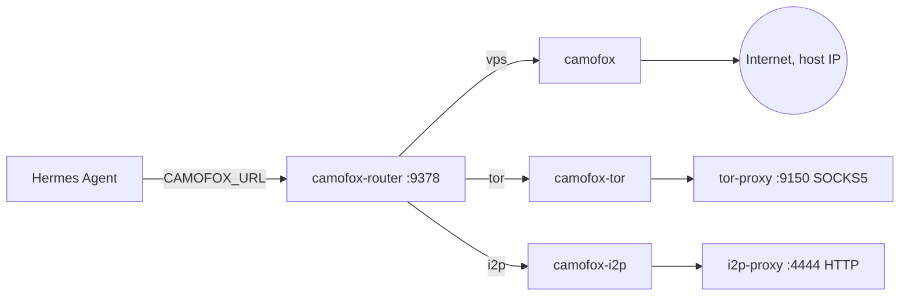

# Hermes Stealth Stack

Stealth browsing, Tor and I2P for [Hermes Agent](https://github.com/NousResearch/hermes-agent), with a small multi-engine router that decides which network exit each browser tab uses.

[](https://opensource.org/licenses/MIT)

**Current version: v1.0.12** (multi-engine tabs, dead tab recovery)

---

## Table of contents

1. [What it is](#what-it-is)
2. [Architecture](#architecture)
3. [Requirements](#requirements)
4. [Installation (step by step)](#installation-step-by-step)
5. [Tutorial](#tutorial)
6. [Plugins reference](#plugins-reference)
7. [Router reference](#router-reference)
8. [Configuration](#configuration)
9. [Tests and CI](#tests-and-ci)
10. [Troubleshooting](#troubleshooting)
11. [Security model and limits](#security-model-and-limits)
12. [Changelog](#changelog)
13. [Repository layout](#repository-layout)
14. [License and credits](#license-and-credits)

---

## What it is

The stack gives Hermes two complementary ways to browse.

**1. Fast readers.** Seven Hermes plugins that fetch a page and return text. Simple, quick, no interaction. See [Plugins reference](#plugins-reference).

**2. Interactive browsers.** Three [camofox-browser](https://github.com/jo-inc/camofox-browser) instances, each with a different network exit, behind a FastAPI router. They support clicks, form filling, JavaScript execution and persistent sessions, through Hermes' `browser_*` tools.

| URL prefix | Engine | Exit |
|------------|--------|------|
| `vps+` or none (new tab) | `camofox` | Host IP |
| `tor+` | `camofox-tor` | Tor exit node |
| `i2p+` | `camofox-i2p` | I2P network |
| `*.onion` | `camofox-tor` (automatic) | Tor |
| `*.i2p` | `camofox-i2p` (automatic) | I2P |

### Which tool for which task

| Task | Tool |
|------|------|
| Read a simple page | `browser_http` |
| Read a JS page | `browser_clear` |
| Read a bot-protected site | `browser_camoufox` |
| Read anonymously | `browser_tor` |
| Read a `.i2p` site | `browser_i2p` |
| Web search | `searxng_search` |
| Cloudflare-protected page | `solverr_fetch` |
| Fill a form or log in | `browser_navigate` + `browser_type` |
| Navigate and interact over Tor | `browser_navigate` with `tor+https://...` |
| Visit a `.onion` | `browser_navigate` with `http://xxx.onion` or `tor+http://xxx.onion` |

Decision rule: if you only need to **read**, use a plugin. If you need to **interact** (click, form, login), use `browser_navigate` and pick the exit with the URL prefix.

---

## Architecture



### Tabsets

Hermes only ever sees one **public tab id** per task. Behind it the router keeps a *tabset*:

```
public tab id -> { uid, active engine, tabs: { vps: realId, tor: realId, i2p: realId } }
```

- `snapshot`, `click`, `type` and every other action go to the **active** tab of the tabset.
- Navigating with an explicit prefix (`vps+`, `tor+`, `i2p+`) to a different engine **never navigates the wrong tab**. The router creates a tab on the requested engine (or reuses the parked one), makes it active, and parks the previous one.
- Parked tabs keep their page and cookies until the engine's idle timeout.
- Each engine has its own isolated browser context: **logins are not shared between engines**.
- Several Hermes tasks (subagents) use different `userId`s, so they get separate contexts, each on its own engine.
- State is kept in memory. A router restart clears it (see [Troubleshooting](#troubleshooting)).

### Derived Camofox image

camofox-browser does not read Firefox `user.js` files. `camofox/Dockerfile` therefore builds a small derived image that patches the launch options in `/app/server.js`: `block_webrtc: true` plus `firefox_user_prefs` (`network.proxy.socks_remote_dns=true`, `media.peerconnection.enabled=false`). The build fails loudly if the upstream string changes. Pin `CAMOFOX_IMAGE` to a digest for reproducible builds.

---

## Requirements

- Docker with Compose v2
- Hermes Agent running in Docker (container named `hermes`)
- A Docker network shared by Hermes, the Camofox containers and the router (default `ai-net`, created by the installer if missing)
- A `tor-proxy` container (SOCKS5 on `:9150`) for `camofox-tor`
- An `i2p-proxy` container (HTTP proxy on `:4444`) for `camofox-i2p`

The proxy and reader containers come from [openwebui-tor-i2p-scraper](https://github.com/thotganesh/openwebui-tor-i2p-scraper). That project builds, on the same `ai-net` network:

| Container | Role | Port |
|-----------|------|------|
| `tor-proxy` | Tor + Snowflake (SOCKS5; ControlPort for NEWNYM) | 9150 / 9151 |
| `i2p-proxy` | i2pd router (HTTP proxy) | 4444 |
| `browser-clear` | Chromium reader with stealth | 8080 |
| `browser-tor` | Firefox reader over Tor | 8081 |
| `browser-i2p` | Firefox reader over I2P | 8083 |

Start that stack first, then install this one. It also needs outgoing UDP open for Snowflake and a few minutes of I2P warm-up on first boot.

### Containers used by the fast-reader plugins

The plugins are thin HTTP clients. Each one calls a separate container that is **not** started by this compose file:

| Plugin | Calls | Provided by |
|--------|-------|-------------|
| `browser_http` | `http://browser-http:8084/browse` | separate container, not published in either repo |
| `browser_clear` | `http://browser-clear:8080/browse` | openwebui-tor-i2p-scraper |
| `browser_camoufox` | `http://browser-camoufox:8085/browse` | separate container, not published in either repo |
| `browser_i2p` | `http://browser-i2p:8083/browse` | openwebui-tor-i2p-scraper |
| `browser_tor` | `http://browser-tor:8081/browse` (override with `BROWSER_TOR_URL`) | openwebui-tor-i2p-scraper, or `browser-tor/` in this repo |
| `searxng_search` | `http://searxng:8080/search` | `searxng` service (profile `full`) |
| `solverr_fetch` | `http://solverr:8191` (override with `SOLVERR_URL`) | `solverr` service (profile `full`) |

The interactive browsers (`browser_navigate`, `browser_snapshot`, ...) only need the router and the Camofox containers. A plugin whose container is missing returns an error string; the others keep working.

---

## Installation (step by step)

### One-shot install (Tor/I2P stack + Hermes stack)

`install-all.sh` installs both halves on a fresh server: first [openwebui-tor-i2p-scraper](https://github.com/thotganesh/openwebui-tor-i2p-scraper) (Tor + Snowflake, I2P, reader containers), then this stack through `./install.sh`.

```bash
git clone https://github.com/thotganesh/hermes-stealth-stack.git
cd hermes-stealth-stack
./install-all.sh
```

What it does:

1. Checks Docker and Compose v2 and creates the Docker network if missing.
2. Clones the scraper project (or fast-forwards an existing clone) and prepares `i2p-data`.
3. Generates the Tor ControlPort password and its hash when they are empty, writes them to the `.env` files (mode 600) and never prints them.
4. Starts `tor-proxy`, `i2p-proxy`, `browser-clear`, `browser-i2p` and `browser-tor`, plus `browser-http`, `browser-camoufox`, `solverr` and `searxng` when their folders exist in the scraper project. It waits for Tor to bootstrap.
5. Connects the `hermes` container to the network if needed, then runs `./install.sh`.

Options (environment variables):

| Variable | Default | Purpose |
|----------|---------|---------|
| `SCRAPER_DIR` | `~/openwebui-tor-i2p-scraper` | Where the scraper project lives; an existing directory is used as is |
| `SCRAPER_REPO` | GitHub URL of the scraper project | Repository to clone |
| `SCRAPER_REF` | unset | Branch or tag to check out after cloning |
| `BROWSER_TOR` | `scraper` | `scraper` runs the scraper's `browser-tor`; `hermes` runs the one in `browser-tor/` of this repo |
| `SKIP_SCRAPER=1` | off | Skip part 1 |
| `SKIP_HERMES=1` | off | Skip part 2 |

The script can be re-run. Containers it does not start (`browser-http`, `browser-camoufox` when their folders are missing) are reported as warnings, and the matching plugins return errors until those containers exist.

> **Status:** the script passes a syntax check but has not yet been tested end to end on a clean server. On a machine that already runs both stacks, use `SKIP_HERMES=1`, because part 2 recreates the Camofox containers and restarts Hermes, which closes open tabs.

To install each half yourself, follow the manual steps below.

### 1. Clone and configure

```bash
git clone https://github.com/thotganesh/hermes-stealth-stack.git
cd hermes-stealth-stack
cp .env.example .env
```

Edit `.env` if needed (network name, image pins, proxy host names). Never commit `.env`.

### 2. Run the installer

```bash
./install.sh
```

What it does:

1. Checks Docker and Compose v2; creates the network if it does not exist.
2. Warns if `tor-proxy` or `i2p-proxy` are not running.
3. Copies the plugins into `~/.hermes/plugins/` (all 7 with `INSTALL_FULL=true`, 5 otherwise). Set `HERMES_HOME` if your Hermes data is elsewhere.
4. Builds and starts `camofox`, `camofox-tor`, `camofox-i2p`, `camofox-router`, plus `searxng` and `solverr` in full mode. Existing `searxng`/`solverr` containers are reused, not touched. A `SEARXNG_SECRET` is generated if empty.
5. Waits for the router healthcheck.
6. Sets `CAMOFOX_URL=http://camofox-router:9378` (and `SEARXNG_URL`, `SOLVERR_URL`) in `~/.hermes/.env`.
7. Enables the plugins and restarts the `hermes` container. If `HERMES_RESTART_UNIT` is set, it restarts that systemd unit too.

### 3. Verify

```bash
docker compose ps
docker run --rm --network ai-net curlimages/curl:latest -s http://camofox-router:9378/health
```

### 4. First test from Hermes

```
/new
Use browser_navigate to visit tor+https://check.torproject.org/api/ip
```

You should see `"IsTor":true`.

### Optional: `browser-tor` container

```bash
./install-browser-tor.sh
```

Requires `TOR_CONTROL_PASSWORD` in `.env`, the same password as the ControlPort (9151) of your `tor-proxy`. If a `browser-tor` container already exists it is left untouched. The fresh-install path of this script is untested.

---

## Tutorial

The router is not published on a host port. The examples run `curl` from a container on the same network:

```bash
alias rcurl='docker run --rm --network ai-net curlimages/curl:latest -s'
```

### 1. Check that everything is up

```bash
rcurl http://camofox-router:9378/health
rcurl http://camofox-router:9378/router/stats
```

### 2. Open a tab over Tor

```bash
rcurl -X POST http://camofox-router:9378/tabs \
  -H 'Content-Type: application/json' \
  -d '{"userId":"demo","url":"tor+https://check.torproject.org/api/ip"}'
```

The response contains a `tabId`. Read the page:

```bash
rcurl "http://camofox-router:9378/tabs/<TAB_ID>/snapshot?userId=demo"
```

Expected: `{"IsTor":true,"IP":"..."}`.

### 3. Switch engine on the same tab

```bash
rcurl -X POST http://camofox-router:9378/tabs/<TAB_ID>/navigate \
  -H 'Content-Type: application/json' \
  -d '{"userId":"demo","url":"vps+https://example.com"}'
```

The response includes `"switched": true` and `"switched_from": "tor"`. The Tor tab stays alive in the background.

### 5. Switch back without reloading

A prefix with no URL reactivates the parked tab exactly as it was:

```bash
rcurl -X POST http://camofox-router:9378/tabs/<TAB_ID>/navigate \
  -H 'Content-Type: application/json' \
  -d '{"userId":"demo","url":"tor+"}'
```

Since v1.0.12 the router first checks that the tab still exists on the engine. If it was destroyed you get `409 no_tab_on_backend` instead of a false success.

### 6. `.onion` and `.i2p`

Routed automatically: a `.onion` URL goes to Tor, a `.i2p` URL goes to I2P, no prefix needed.

### 7. Clean up

```bash
rcurl -X DELETE "http://camofox-router:9378/sessions/demo"
```

### 8. Use it from Hermes

```
Open tor+https://check.torproject.org/api/ip and tell me IsTor and the IP.
Then open vps+https://example.com.
Then go back to the Tor tab with tor+ alone, without reloading.
```

### Prefix rules

- **New tab, no prefix:** the session's engine, or `vps` (host IP) if there is none.
- **Existing tab, URL without prefix:** stays on the engine the tab is currently on. It never switches silently.
- **Existing tab, explicit prefix:** switches engine as described above.

Forgetting `tor+` on a new tab means the request leaves from the host IP. Verify with `check.torproject.org/api/ip` whenever anonymity matters.

---

## Plugins reference

All plugins live in `plugins/<name>/` (`plugin.yaml` + `__init__.py`), are installed by `install.sh`, and are enabled with `hermes plugins enable <name>`. Output is returned as text, truncated to roughly 5000 characters (4500 for the `browser_tor` text field). Error messages returned by the plugins are in Italian.

| Plugin | Parameters | Timeout | Typical speed | JS |
|--------|-----------|---------|---------------|----|
| `browser_http` | `url` | 30 s | ~200 ms | no |
| `browser_clear` | `url`, `wait_selector` (optional CSS selector) | 60 s | 1-3 s | yes |
| `browser_camoufox` | `url`, `wait_ms` (default 5000) | 90 s | 2-5 s | yes |
| `browser_tor` | `url`, `wait_selector` (optional) | 100 s | 3-10 s | yes |
| `browser_i2p` | `url` | 60 s | 10-60 s | yes |
| `searxng_search` | `query`, `limit` (default 5) | 30 s | < 1 s | n/a |
| `solverr_fetch` | `url` (validated: http/https, public hosts only) | see plugin | 10-30 s | n/a |

- **browser_http**: direct fetch with Chrome impersonation (curl_cffi). Best for plain HTML and APIs.
- **browser_clear**: stealth Chromium, for modern SPAs and pages with light anti-bot protection.
- **browser_camoufox**: stealth Firefox with `humanize` enabled and a Windows profile, for sites that block Chromium.
- **browser_tor**: anonymous reads; NEWNYM before every request. Responses include `circuit_renewed`; set `TOR_REQUIRE_NEWNYM=1` on the `browser-tor` container to fail instead of reusing a circuit. Rejected URLs return a message with the reason.
- **browser_i2p**: reads through the I2P HTTP proxy, for `.i2p` sites.
- **searxng_search**: self-hosted metasearch (JSON API); returns title, URL and a 200-character snippet per result.
- **solverr_fetch**: solves Cloudflare/Turnstile challenges through FlareSolverr (community fork `ghcr.io/unseensnick/solverr`, override with `SOLVERR_IMAGE`).

### Interactive tools (provided by Hermes, routed by this stack)

| Tool | Purpose |
|------|---------|
| `browser_navigate` | Open a URL. Prefix `tor+` / `i2p+` / `vps+` selects the exit. Returns `{tabId, url, httpStatus, navigationOk}` |
| `browser_snapshot` | Structured DOM snapshot of the active tab |
| `browser_click` | Click an element by ref |
| `browser_type` | Type into a form field |
| `browser_scroll`, `browser_back`, `browser_press` | Navigation helpers |
| `browser_console` | Run JavaScript in the page |

---

## Router reference

### Routes (fail-closed)

Only these are forwarded; everything else returns `404 route_not_supported`.

| Route | Purpose |
|-------|---------|
| `POST /tabs` | Create a tab |
| `GET /tabs?userId=` | List tabs across all engines (merged, each with a `backend` field) |
| `/tabs/{id}` and `/tabs/{id}/{action}` | Actions on the tab (`navigate`, `snapshot`, `click`, ...) |
| `DELETE /tabs/{id}` | Close **all** tabs of the tabset |
| `/sessions/{userId}/...` | Session endpoints (cookies, traces); `DELETE /sessions/{userId}` fans out to every known engine |
| `GET /health`, `GET /router/stats` | Diagnostics |

Responses carry an `x-router-backend` header with the engine that served them. Session-level calls that cannot be attributed to one engine need an `X-Camofox-Backend` header.

### Error codes

| HTTP | Code | Meaning / fix |
|------|------|---------------|
| 400 | `invalid_json`, `body_required`, `userId_required` | Malformed request |
| 400 | `proxy_override_not_allowed` | Tab creation with a `proxy` field is rejected |
| 400 | `url_rejected` | URL not allowed: non-http(s), or loopback/private/internal/ambiguous host on `vps` |
| 401 | `unauthorized` | `ROUTER_API_KEY` is set and the Bearer token is missing or wrong |
| 403 | `upload_disabled` | Set `ROUTER_ALLOW_UPLOAD=1` to enable `/upload` |
| 404 | `route_not_supported` | Legacy/global endpoint, blocked by design |
| 404 | `backend_tab_gone` | The engine destroyed the tab (it answered 410). The tab was removed from the tabset: create a new one |
| 409 | `backend_mismatch` | Prefix for another engine on a non-navigate call, or auto-switch disabled |
| 409 | `tab_backend_unknown` | Tab id unknown (expired or router restarted): create a new tab |
| 409 | `no_tab_on_backend` | Bare prefix (e.g. `tor+`) but no live tab on that engine. `detail: tab_gone` if it died. Navigate to `tor+https://...` to open one |
| 409 | `session_backend_unknown`, `ambiguous_backend`, `backend_not_known_for_user` | Session-level calls where the engine cannot be inferred |
| 502 | `backend_unreachable`, `backend_bad_response` | Engine down or invalid answer |
| 207 | (multi-status) | Partial result when closing tabs on several engines |

### Dead tab handling (v1.0.12)

| Situation | Router behaviour |
|-----------|------------------|
| Engine answers 410 on `/tabs/{id}/...` | Returns `404 backend_tab_gone`, drops the dead tab from the tabset |
| Bare `tor+` and the tab is gone on the engine | `409 no_tab_on_backend`, tab dropped |
| Bare `tor+` and the engine is unreachable | Tab is kept (it cannot be verified), switch proceeds |
| `tor+https://...` on a parked tab that returns 404/410 | Tab recreated transparently, response has `"recreated": true` |

A tab usually dies because an action timed out (for example a click that never completes, logged by the engine as `operation_timeout`) and the engine discards it.

---

## Configuration

Copy `.env.example` to `.env`.

### Compose variables

| Variable | Default | Purpose |
|----------|---------|---------|
| `DOCKER_NETWORK` | `ai-net` | Shared external network |
| `CAMOFOX_IMAGE` | `ghcr.io/jo-inc/camofox-browser:latest` | Base image (pin a digest for reproducible builds) |
| `CAMOFOX_VPS_URL`, `CAMOFOX_TOR_URL`, `CAMOFOX_I2P_URL` | `http://camofox*:9377` | Engine URLs used by the router |
| `TOR_SOCKS_HOST`, `TOR_SOCKS_PORT` | `tor-proxy`, `9150` | Tor SOCKS5 proxy |
| `I2P_HTTP_HOST`, `I2P_HTTP_PORT` | `i2p-proxy`, `4444` | I2P HTTP proxy |
| `SEARXNG_URL`, `SOLVERR_URL` | `http://searxng:8080`, `http://solverr:8191` | Written into Hermes' `.env` |
| `SEARXNG_IMAGE`, `SOLVERR_IMAGE`, `CURL_IMAGE` | see `.env.example` | Image overrides |
| `INSTALL_FULL` | `true` | Also install the SearXNG and Solverr plugins and containers |
| `SEARXNG_SECRET` | generated | SearXNG secret |
| `HERMES_RESTART_UNIT` | unset | systemd unit to restart after install |
| `TOR_CONTROL_PASSWORD`, `TOR_REQUIRE_NEWNYM` | empty, `0` | `browser-tor` container |
| `ROUTER_API_KEY` | empty (off) | Optional Bearer authentication |

### Router variables

| Variable | Default | Purpose |
|----------|---------|---------|
| `ROUTER_API_KEY` | empty | If set, every request needs `Authorization: Bearer <key>`. The built-in Hermes browser tools do not send it, so leave it empty unless you use a custom client |
| `ROUTER_AUTO_SWITCH` | `1` | Allow engine switching on `navigate`. With `0`, a different prefix returns `409 backend_mismatch` (the pre-v1.0.11 behaviour) |
| `ROUTER_ALLOW_UPLOAD` | `0` | Allow `/upload` |
| `ROUTER_STATE_TTL` | `3600` | Seconds of inactivity before router state expires |
| `ROUTER_MAX_ENTRIES` | `10000` | Cap per state map |

The provided compose files only pass `ROUTER_API_KEY` through. To change the others, add them to the `camofox-router` `environment:` section of `docker-compose.override.yml` and recreate the container.

### Resources

The override gives each Camofox container `shm_size: 1gb` and `mem_limit: 2g`. The router has a healthcheck on `/health`.

### Idle timeouts

Camofox shuts the browser down when idle and reaps inactive tabs. Hermes has its own inactivity setting:

```bash
hermes config set browser.inactivity_timeout 600
```

The Hermes default is 120 seconds. Raise it for long multi-step flows so parked tabs survive. If `hermes` is not in the host PATH, run it inside its container (`docker exec hermes hermes config set ...`) and restart Hermes if the value does not apply.

---

## Tests and CI

### Scripts

| Script | What it checks |
|--------|----------------|
| `./test-privacy.sh` | WebRTC disabled on every backend (`RTCPeerConnection` must be `undefined`), `IsTor: true` on `camofox-tor`, no UDP/DNS outside the proxy (35 s capture) |
| `./test-i2p.sh` | I2P fail-safe: stops `i2p-proxy` briefly, expects an error and no silent leak through the host IP, restarts it |
| `./test-privacy-i2p.sh` | 60 s DNS/UDP capture on `camofox-i2p` (outbound connections only) |
| `./test-routing.sh` | Legacy routes blocked (404), private/`file://`/internal URLs rejected (400), unknown tab and session (409), `proxy` field rejected, Tor tab exits from Tor |
| `./test-multitab.sh` | A vps tab and a tor tab in parallel for the same user, merged `GET /tabs`, Tor exit, engine switch without leak, `vps+` reactivation with state preserved, private URL rejected via switch, session cleanup |
| `camofox/router/test_router_dead_tabs.py` | Dead tab handling (v1.0.12) against a fake backend. Touches no real engine |

`test-routing.sh` and `test-multitab.sh` use a container as `curl` client. The default is `open-webui`; override with `CURL_CONTAINER=<container>` (any container on the network that has `curl`). The router URL is `ROUTER_URL` (default `http://camofox-router:9378`).

> **Note:** parts of `test-routing.sh` (navigating a vps tab to `tor+` or a `.onion`, expecting `409`) describe the pre-v1.0.11 behaviour and apply with `ROUTER_AUTO_SWITCH=0`. With the default (`1`) the router switches engine instead. `test-multitab.sh` covers the current behaviour.

Run the dead tab tests inside the router container:

```bash
cd camofox/router
docker cp test_router_dead_tabs.py camofox-router:/app/
docker exec camofox-router python /app/test_router_dead_tabs.py
```

Expected last line: `ALL TESTS PASSED`. The file is not part of the image, so copy it each time.

### Continuous integration

`.github/workflows/ci.yml` runs on every push and pull request:

1. `shellcheck` on `install.sh` and `test-privacy.sh`
2. `docker compose --profile full config -q` with `.env.example`
3. `py_compile` of the router and all plugins
4. Build of the router image
5. Build of the patched Camofox image (fails if the upstream `server.js` patch string changed)

The CI does not run the router behaviour tests; run them locally.

---

## Troubleshooting

### I changed `router.py` but nothing changed
The router code is **baked into the image** (no bind mount), so `docker restart` is not enough. Rebuild:

```bash
docker compose up -d --build camofox-router
```

Rebuilding with the override can also recreate the Camofox engines, which closes their open tabs.

### `409 tab_backend_unknown` after a restart
Router state is in memory. After a restart or rebuild, create a new tab. `GET /tabs?userId=...` re-registers live tabs that exist on exactly one engine.

### Hermes keeps failing on a dead tab
Before v1.0.12 the router passed a backend `410 Gone` through unchanged and kept the dead tab in the tabset. Upgrade to v1.0.12: the client then receives `404 backend_tab_gone` and creates a new tab.

### See what the router is doing
Every tab creation and engine switch writes a log line with the chosen engine:

```bash
docker logs --since 30m camofox-router 2>&1 | grep -vE "GET /health|snapshot|evaluate" | tail -40
docker logs --since 30m camofox-tor 2>&1 | tail -20
```

Router log messages are in Italian: `nuovo tab` (new tab), `riattivato` (reactivated), `navigate su tab parcheggiato` (navigate on parked tab), plus warnings for dead tabs.

### `WARNING: Unsupported upgrade request`
Harmless uvicorn noise from websocket probes.

### `proxy pool created but browser pre-warm failed`
Tor/I2P proxies may be slow to start. Wait 30-60 seconds and retry. Check `docker logs camofox-tor --tail 20` and `docker logs camofox-i2p --tail 20`.

### `browser_exec cannot connect to Docker daemon`
Hermes is in Browser Use mode. The stack bypasses it through `CAMOFOX_URL`: verify it points to the router and that the Camofox containers are healthy.

### Router not reachable from Hermes
All containers must be on the same Docker network: `docker network inspect ai-net`.

### The Tor exit did not change
`camofox-tor` and `tor-proxy` are separate containers; restarting `camofox-tor` does not renew the circuit. NEWNYM goes to the shared `tor-proxy` and affects every user of it.

---

## Security model and limits

- **Trusted network.** The router is designed for a private, single-user deployment. By default it has no authentication; any container on the network can create tabs, read snapshots and impersonate another `userId`. Enable `ROUTER_API_KEY` for custom clients. Do not expose port 9378 publicly; use an SSH tunnel or an authenticating reverse proxy for remote access.
- **Fail-closed routing.** Only the routes listed above are forwarded. Legacy endpoints are blocked.
- **Backend is never guessed.** An unknown tab id returns 409 rather than being sent to the default engine.
- **URL validation.** Only `http`/`https`. On `vps`, loopback, private, internal and ambiguous numeric hosts are rejected, including via switch. `solverr_fetch` and `browser-tor` validate URLs too.
- **Isolated engine contexts.** Cookies and logins are not shared across engines.
- **Bounded state.** Router state expires after `ROUTER_STATE_TTL` and each map is capped at `ROUTER_MAX_ENTRIES`.
- **Privacy hardening.** WebRTC off and remote DNS in the derived image; verify with `./test-privacy.sh`.

### SSRF risk
`camofox-tor` and `camofox-i2p` run with `CAMOFOX_ALLOW_PRIVATE_NETWORK=true` so the browser can reach the proxy containers. A page or an agent-driven navigation can therefore reach other services on the same Docker network (Hermes, Open WebUI, ...). Mitigations: keep the Camofox stack on a network shared only with the proxies, do not let untrusted input drive `browser_navigate`, and use firewall rules to limit these containers to the proxy ports.

### Anonymity disclaimer
Camoufox with Tor is **not** equivalent to Tor Browser. Camoufox randomizes the fingerprint while Tor Browser makes all users look the same, so the threat model is different and it does not defend against advanced correlation. A new tab with no prefix exits from the **host IP**. Traffic analysis, timing attacks and malicious exit nodes are out of scope. NEWNYM is global for the shared `tor-proxy` and can change the exit of an ongoing `camofox-tor` session. Page content returned to the agent is untrusted input (prompt injection). Use this stack as a convenience layer for scripted browsing, not as a replacement for Tor Browser.

### Responsible use
Respect the terms of service of the sites you automate and the laws that apply to you. This project does not help bypass the anti-abuse systems of third-party services.

---

## Changelog

### v1.0.12 - Dead tab handling
- Backend `410` on `/tabs/{id}/...` is mapped to `404 backend_tab_gone` and the dead tab is removed from the tabset.
- Bare engine switch (`tor+`) probes the backend first and returns `409 no_tab_on_backend` if the tab is gone.
- Navigating a parked tab that died on the backend recreates it transparently (`recreated: true`).
- Automated tests in `camofox/router/test_router_dead_tabs.py`.

### v1.0.11 - Multi-engine tabs
- Per-request engine selection with `tor+`, `i2p+`, `vps+`.
- Bare prefix switches to an existing tab without reloading.
- `.onion` and `.i2p` routed automatically.
- Isolated browser contexts per engine.
- New errors `no_tab_on_backend` and `tab_backend_unknown`.
- Added `test-multitab.sh`.

### Earlier versions
Privacy hardening (v1.0.3), fail-closed router and URL validation (v1.0.6), optional `browser-tor` container. See the [releases page](../../releases) and `git tag -l`.

---

## Repository layout

```
hermes-stealth-stack/
├── plugins/                  # 7 Hermes plugins (plugin.yaml + __init__.py)
├── camofox/
│   ├── Dockerfile            # derived image with privacy patches
│   ├── prefs/user.js
│   └── router/               # FastAPI router, Dockerfile, tests
├── browser-tor/              # optional browser-tor container
├── searxng/settings.yml
├── docs/
│   ├── INSTALL.md
│   ├── TOOLS.md
│   ├── MULTITAB.md           # multi-engine tabs
│   ├── ARCHITECTURE.md
│   └── SKILL-stealth-web-stack-multitab.md   # Hermes skill notes
├── .github/workflows/ci.yml
├── docker-compose.yml
├── docker-compose.override.yml
├── docker-compose.browser-tor.yml
├── install-all.sh            # one-shot installer (scraper stack + this stack)
├── install.sh
├── install-browser-tor.sh
├── test-*.sh
└── .env.example
```

---

## License and credits

MIT - see [LICENSE](LICENSE).

- [Camoufox](https://camoufox.com/) by daijiro
- [camofox-browser](https://github.com/jo-inc/camofox-browser) by jo-inc
- [Hermes Agent](https://github.com/NousResearch/hermes-agent) by Nous Research
- `ghcr.io/unseensnick/solverr`, a community FlareSolverr fork
- [openwebui-tor-i2p-scraper](https://github.com/thotganesh/openwebui-tor-i2p-scraper): Tor/Snowflake and I2P proxies and the reader containers this stack builds on
