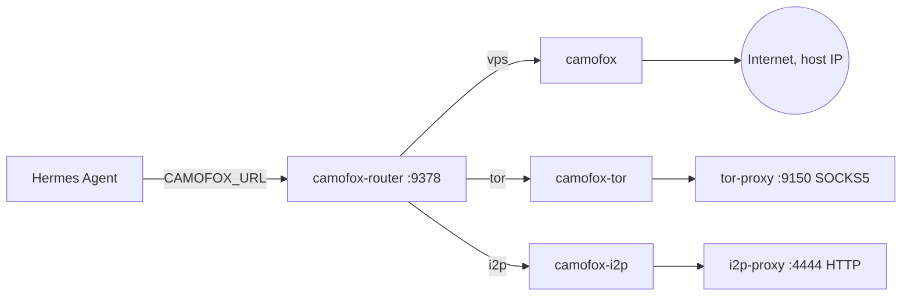

# Hermes Stealth Stack

Stealth browsing, Tor and I2P for [Hermes Agent](https://github.com/NousResearch/hermes-agent), with a small multi-engine router that decides which exit each tab uses.

[](https://opensource.org/licenses/MIT)

**Current version: v1.0.12** (multi-engine tabs, dead tab recovery)

---

## Table of contents

1. [What it is](#what-it-is)
2. [Architecture](#architecture)
3. [Requirements](#requirements)
4. [Installation](#installation)
5. [Tutorial](#tutorial)
6. [Router reference](#router-reference)
7. [Configuration](#configuration)
8. [Tests](#tests)
9. [Troubleshooting](#troubleshooting)
10. [Security model and limits](#security-model-and-limits)
11. [Changelog](#changelog)
12. [Repository layout](#repository-layout)
13. [License and credits](#license-and-credits)

---

## What it is

The stack gives Hermes two complementary ways to browse.

### 1. Fast readers (7 plugins)

| Plugin | Purpose | Backend |
|--------|---------|---------|
| `browser_http` | Direct HTTP fetch | curl_cffi (Chrome impersonation) |
| `browser_clear` | JS-heavy pages | Patchright (stealth Chromium) |
| `browser_camoufox` | Anti-bot pages | Camoufox (patched Firefox) |
| `browser_tor` | Anonymous reads | Tor (NEWNYM per request) |
| `browser_i2p` | I2P network | i2pd HTTP proxy |
| `searxng_search` | Web search | Self-hosted SearXNG |
| `solverr_fetch` | Cloudflare challenges | FlareSolverr |

### 2. Interactive browsers (Camofox + router)

Three [camofox-browser](https://github.com/jo-inc/camofox-browser) instances, each with a different network exit, behind a FastAPI router. They support clicks, form filling, JavaScript execution and persistent sessions.

| URL prefix | Engine | Exit |
|------------|--------|------|
| `vps+` or none (new tab) | `camofox` | Host IP |
| `tor+` | `camofox-tor` | Tor exit node |
| `i2p+` | `camofox-i2p` | I2P network |
| `*.onion` | `camofox-tor` (automatic) | Tor |
| `*.i2p` | `camofox-i2p` (automatic) | I2P |

### Which tool for which task

| Task | Tool |
|------|------|
| Read a simple page | `browser_http` |
| Read a JS page | `browser_clear` |
| Read a bot-protected site | `browser_camoufox` |
| Read anonymously | `browser_tor` |
| Read a `.i2p` site | `browser_i2p` |
| Fill a form or log in | `browser_navigate` + `browser_type` |
| Navigate and interact over Tor | `browser_navigate` with `tor+https://...` |
| Visit a `.onion` | `browser_navigate` with `http://xxx.onion` or `tor+http://xxx.onion` |

---

## Architecture



### Tabsets

Hermes only ever sees one **public tab id**. Behind it the router keeps a *tabset*:

```
public tab id -> { uid, active engine, tabs: { vps: realId, tor: realId, i2p: realId } }
```

- `snapshot`, `click`, `type` and every other action go to the **active** tab of the tabset.
- Navigating with an explicit prefix (`vps+`, `tor+`, `i2p+`) to a different engine **never navigates the wrong tab**. The router creates a tab on the requested engine (or reuses the parked one), makes it active, and parks the previous one.
- Parked tabs keep their page and cookies until the engine's idle timeout.
- Each engine has its own isolated browser context: **logins are not shared between engines**.
- State is in memory. A router restart clears it (see [Troubleshooting](#troubleshooting)).

---

## Requirements

- Docker with Compose v2
- Hermes Agent running in Docker
- A Docker network shared by Hermes, the Camofox containers and the router (default `ai-net`)
- A `tor-proxy` container (SOCKS5 on `:9150`) for `camofox-tor`
- An `i2p-proxy` container (HTTP proxy on `:4444`) for `camofox-i2p`

If you need the proxy containers, see [openwebui-tor-i2p-scraper](https://github.com/thotganesh/openwebui-tor-i2p-scraper).

---

## Installation

```bash
git clone https://github.com/thotganesh/hermes-stealth-stack.git
cd hermes-stealth-stack
cp .env.example .env
./install.sh
```

The installer:

1. Checks Docker and Compose v2, creates the network if missing.
2. Warns if `tor-proxy` or `i2p-proxy` are not running.
3. Copies the plugins into `~/.hermes/plugins/` (7 with `INSTALL_FULL=true`, 5 otherwise).
4. Builds and starts `camofox`, `camofox-tor`, `camofox-i2p`, `camofox-router` (plus `searxng` and `solverr` in full mode, reusing existing containers).
5. Waits for the router healthcheck.
6. Sets `CAMOFOX_URL=http://camofox-router:9378` (and `SEARXNG_URL`, `SOLVERR_URL`) in Hermes' `.env`.
7. Enables the plugins and restarts the `hermes` container.

> `docker-compose.override.yml` builds a derived image (`hermes-stealth/camofox:1.0.3`) that applies privacy patches (WebRTC off, remote DNS). Use `docker compose up -d --build` so the override is applied.

Optional `browser_tor` container:

```bash
./install-browser-tor.sh
```

It needs a `tor-proxy` whose ControlPort (9151) uses the password set as `TOR_CONTROL_PASSWORD` in `.env`. The fresh-install path of this script is untested.

---

## Tutorial

The router is not published on a host port. Examples below run `curl` from a container on the same network. Replace `ai-net` if you changed `DOCKER_NETWORK`.

```bash
alias rcurl='docker run --rm --network ai-net curlimages/curl:latest -s'
```

### 1. Check that everything is up

```bash
rcurl http://camofox-router:9378/health
rcurl http://camofox-router:9378/router/stats
```

`/health` reports each engine; `/router/stats` shows router state counters.

### 2. Open a tab over Tor

```bash
rcurl -X POST http://camofox-router:9378/tabs \
  -H 'Content-Type: application/json' \
  -d '{"userId":"demo","url":"tor+https://check.torproject.org/api/ip"}'
```

The response contains a `tabId`. Read the page:

```bash
rcurl "http://camofox-router:9378/tabs/<TAB_ID>/snapshot?userId=demo"
```

Expected: `{"IsTor":true,"IP":"..."}`.

### 3. Switch engine on the same tab

```bash
rcurl -X POST http://camofox-router:9378/tabs/<TAB_ID>/navigate \
  -H 'Content-Type: application/json' \
  -d '{"userId":"demo","url":"vps+https://example.com"}'
```

The response includes `"switched": true` and `"switched_from": "tor"`. The Tor tab stays alive in the background.

### 4. Switch back without reloading

A prefix with no URL reactivates the parked tab as it was:

```bash
rcurl -X POST http://camofox-router:9378/tabs/<TAB_ID>/navigate \
  -H 'Content-Type: application/json' \
  -d '{"userId":"demo","url":"tor+"}'
```

From v1.0.12 the router first checks that the tab still exists on the engine. If it was destroyed, you get `409 no_tab_on_backend` instead of a false success.

### 5. `.onion` and `.i2p`

These are routed automatically: a `.onion` URL goes to Tor, a `.i2p` URL goes to I2P, with no prefix needed.

### 6. Use it from Hermes

In a Hermes chat, plain language is enough:

```
Open tor+https://check.torproject.org/api/ip and tell me IsTor and the IP.
Then open vps+https://example.com.
Then go back to the Tor tab with tor+ alone, without reloading.
```

### Rule of thumb for prefixes

- **New tab, no prefix:** goes to the session's engine, or `vps` (host IP) if none.
- **Existing tab, URL without prefix:** stays on the engine the tab is currently on.
- **Existing tab, explicit prefix:** switches engine as described above.

Forgetting `tor+` on a new tab means the request leaves from the host IP. Always verify with `check.torproject.org/api/ip` when anonymity matters.

---

## Router reference

### Routes (fail-closed)

Only these are forwarded; everything else returns `404 route_not_supported`.

| Route | Purpose |
|-------|---------|
| `POST /tabs` | Create a tab |
| `GET /tabs?userId=` | List tabs across all engines (merged, with `backend` field) |
| `/tabs/{id}` and `/tabs/{id}/{action}` | Actions on the tab (`navigate`, `snapshot`, `click`, ...) |
| `DELETE /tabs/{id}` | Close **all** tabs of the tabset |
| `/sessions/{userId}/...` | Session endpoints (cookies, traces) |
| `GET /health`, `GET /router/stats` | Diagnostics |

Responses carry an `x-router-backend` header with the engine that served them.

### Error codes

| HTTP | Code | Meaning / fix |
|------|------|---------------|
| 400 | `invalid_json`, `body_required`, `userId_required` | Malformed request |
| 400 | `proxy_override_not_allowed` | Tab creation with a `proxy` field is rejected |
| 400 | `url_rejected` | URL not allowed (non-http(s), or loopback/private/internal host on `vps`) |
| 401 | `unauthorized` | `ROUTER_API_KEY` is set and the Bearer token is missing or wrong |
| 403 | `upload_disabled` | Set `ROUTER_ALLOW_UPLOAD=1` to enable `/upload` |
| 404 | `route_not_supported` | Legacy/global endpoint blocked by design |
| 404 | `backend_tab_gone` | **v1.0.12.** The engine destroyed the tab (it answered 410). The tab was removed from the tabset: create a new one |
| 409 | `backend_mismatch` | Prefix for another engine on a non-navigate call, or auto-switch disabled |
| 409 | `tab_backend_unknown` | Tab id unknown (expired or router restarted): create a new tab |
| 409 | `no_tab_on_backend` | Bare prefix (e.g. `tor+`) but no live tab on that engine. `detail: tab_gone` if it died. Navigate to `tor+https://...` to open one |
| 409 | `session_backend_unknown`, `ambiguous_backend`, `backend_not_known_for_user` | Session-level calls where the engine can't be inferred. Send `X-Camofox-Backend` |
| 502 | `backend_unreachable`, `backend_bad_response` | Engine down or invalid answer |
| 207 | (multi-status) | Partial result when closing tabs on several engines |

### Dead tab handling (v1.0.12)

| Situation | Router behaviour |
|-----------|------------------|
| Engine answers 410 on `/tabs/{id}/...` | Returns `404 backend_tab_gone`, drops the dead tab from the tabset |
| Bare `tor+` and the tab is gone on the engine | `409 no_tab_on_backend`, tab dropped |
| Bare `tor+` and the engine is unreachable | Tab is kept (cannot verify), switch proceeds |
| `tor+https://...` on a parked tab that returns 404/410 | Tab recreated transparently, response has `"recreated": true` |

---

## Configuration

Copy `.env.example` to `.env`.

### Compose variables

| Variable | Default | Purpose |
|----------|---------|---------|
| `DOCKER_NETWORK` | `ai-net` | Shared external network |
| `CAMOFOX_IMAGE` | `ghcr.io/jo-inc/camofox-browser:latest` | Base image (pin a digest for reproducible builds) |
| `CAMOFOX_VPS_URL` / `CAMOFOX_TOR_URL` / `CAMOFOX_I2P_URL` | `http://camofox*:9377` | Engine URLs used by the router |
| `TOR_SOCKS_HOST` / `TOR_SOCKS_PORT` | `tor-proxy` / `9150` | Tor SOCKS5 proxy |
| `I2P_HTTP_HOST` / `I2P_HTTP_PORT` | `i2p-proxy` / `4444` | I2P HTTP proxy |
| `INSTALL_FULL` | `true` | Also install SearXNG and Solverr plugins |
| `SEARXNG_SECRET` | generated | SearXNG secret |
| `TOR_CONTROL_PASSWORD`, `TOR_REQUIRE_NEWNYM` | empty, `0` | `browser-tor` container |
| `ROUTER_API_KEY` | empty (off) | Optional Bearer authentication |

### Router variables

| Variable | Default | Purpose |
|----------|---------|---------|
| `ROUTER_API_KEY` | empty | If set, every request needs `Authorization: Bearer <key>`. The built-in Hermes browser tools do not send it, so leave empty unless you use a custom client |
| `ROUTER_AUTO_SWITCH` | `1` | Allow engine switching on `navigate`. With `0`, a different prefix returns `409 backend_mismatch` |
| `ROUTER_ALLOW_UPLOAD` | `0` | Allow `/upload` |
| `ROUTER_STATE_TTL` | `3600` | Seconds of inactivity before router state expires |
| `ROUTER_MAX_ENTRIES` | `10000` | Cap per state map |

Only `ROUTER_API_KEY` is passed through by the provided compose files. To change the others, add them to the `camofox-router` `environment:` section in `docker-compose.override.yml` and recreate the container.

### Idle timeout

The browser engines shut down when idle, and Hermes has its own tab inactivity setting:

```bash
hermes config set browser.inactivity_timeout 600
```

The Hermes default is 120 seconds. Raise it for long multi-step flows so parked tabs survive. If `hermes` is not in the host PATH, run it inside its container (`docker exec hermes hermes config set ...`) and restart Hermes if the value does not apply.

---

## Tests

All tests run locally against real components, except the router unit tests which use a fake backend.

| Script | What it checks |
|--------|----------------|
| `./test-privacy.sh` | WebRTC off on every backend, `IsTor: true` on `camofox-tor`, no UDP/DNS outside the proxy (35 s capture) |
| `./test-i2p.sh` | I2P fail-safe: stops `i2p-proxy` briefly, expects an error and no silent host-IP leak |
| `./test-privacy-i2p.sh` | 60 s DNS/UDP capture on `camofox-i2p` (outbound connections only) |
| `./test-routing.sh` | `tor+`, `i2p+`, `.onion`, `.i2p` reach the right engine |
| `./test-multitab.sh` | Multi-engine tabs in parallel and switching |
| `camofox/router/test_router_dead_tabs.py` | Dead tab handling (v1.0.12), with a fake backend |

Run the dead tab tests inside the router container (they do not touch real engines):

```bash
cd camofox/router
docker cp test_router_dead_tabs.py camofox-router:/app/
docker exec camofox-router python /app/test_router_dead_tabs.py
```

Expected last line: `ALL TESTS PASSED`. The test file is not part of the image, so it must be copied each time.

---

## Troubleshooting

### I changed `router.py` but nothing changed
The router code is **baked into the image** (no bind mount), so `docker restart` is not enough. Rebuild:

```bash
docker compose up -d --build camofox-router
```

Rebuilding with the override can also recreate the Camofox engines, which closes their open tabs.

### `409 tab_backend_unknown` after a restart
Router state is in memory. After a restart or rebuild, create a new tab. `GET /tabs?userId=...` re-registers live tabs that exist on exactly one engine.

### Hermes keeps failing on a dead tab
Before v1.0.12 the router passed a backend `410 Gone` through unchanged and kept the dead tab in the tabset. Upgrade to v1.0.12: the client then gets `404 backend_tab_gone` and creates a new tab. Typical cause of a destroyed tab: an action timed out (for example a click that never completes, `operation_timeout`) and the engine discarded the tab.

### Check what the router is doing
Every tab creation and engine switch writes a log line with the chosen engine:

```bash
docker logs --since 30m camofox-router 2>&1 | grep -vE "GET /health|snapshot|evaluate" | tail -40
docker logs --since 30m camofox-tor 2>&1 | tail -20
```

Log lines you will see: `create`, `switch ... (nuovo tab)`, `switch ... (riattivato)`, `switch ... (navigate su tab parcheggiato)`, and the v1.0.12 warnings for dead tabs. The log messages are in Italian.

### `WARNING: Unsupported upgrade request`
Harmless uvicorn noise from websocket probes.

### The Tor exit did not change
`camofox-tor` and `tor-proxy` are separate containers. Restarting `camofox-tor` does not renew the circuit. NEWNYM is sent to the shared `tor-proxy` and affects every user of it.

---

## Security model and limits

- **Trusted network.** The router is designed for a private, single-user deployment. By default it has no authentication; any container on the network can create tabs and read snapshots. Enable `ROUTER_API_KEY` for custom clients and do not expose port 9378 publicly (use an SSH tunnel or an authenticating reverse proxy for remote access).
- **Fail-closed routing.** Only the routes listed above are forwarded. Legacy endpoints are blocked.
- **Backend is never guessed.** An unknown tab id returns 409 rather than being sent to the default engine.
- **URL validation.** Only `http`/`https`. On `vps`, loopback, private, internal and ambiguous numeric hosts are rejected. On `tor` and `i2p` these checks are skipped (see the SSRF note).
- **Isolated engine contexts.** Logins and cookies are not shared across engines.
- **Privacy hardening.** The derived image sets `block_webrtc: true` and Firefox prefs for remote DNS and no WebRTC. Verify with `./test-privacy.sh`.

### SSRF risk
`camofox-tor` and `camofox-i2p` run with `CAMOFOX_ALLOW_PRIVATE_NETWORK=true` so the browser can reach the proxy containers. A page (or an agent-driven navigation) can therefore reach other services on the same Docker network. Mitigations: keep the Camofox stack on a network shared only with the proxies, do not let untrusted input drive `browser_navigate`, and use firewall rules to limit the containers to the proxy ports.

### Anonymity disclaimer
Camoufox with Tor is **not** equivalent to Tor Browser. Camoufox randomizes the fingerprint while Tor Browser uniformizes it, so this is a different threat model and does not defend against advanced correlation. An un-prefixed new tab exits from the **host IP**. Traffic analysis, timing attacks and malicious exits are out of scope. Page content returned to the agent is untrusted input (prompt injection). Use this stack as a convenience layer for scripted browsing, not as a substitute for Tor Browser.

### Responsible use
Respect the terms of service of the sites you automate and the laws that apply to you. Anti-abuse systems on third-party services are not something this project helps to bypass.

---

## Changelog

### v1.0.12 - Dead tab handling
- Backend `410` on `/tabs/{id}/...` is mapped to `404 backend_tab_gone` and the dead tab is removed from the tabset.
- Bare engine switch (`tor+`) probes the backend first and returns `409 no_tab_on_backend` if the tab is gone.
- Navigating a parked tab that died on the backend recreates it transparently (`recreated: true`).
- Automated tests in `camofox/router/test_router_dead_tabs.py`.

### v1.0.11 - Multi-engine tabs
- Per-request engine selection with `tor+`, `i2p+`, `vps+`.
- Bare prefix switches to an existing tab without reloading.
- `.onion` and `.i2p` routed automatically.
- Isolated browser contexts per engine.
- New errors `no_tab_on_backend` and `tab_backend_unknown`.
- Added `test-multitab.sh`.

### Earlier versions
Privacy hardening (v1.0.3), fail-closed router and URL validation (v1.0.6), optional `browser-tor` container. See the [releases page](../../releases) and `git tag -l`.

---

## Repository layout

```
hermes-stealth-stack/
├── plugins/                 # 7 Hermes plugins
├── camofox/
│   ├── Dockerfile           # derived image with privacy patches
│   ├── prefs/user.js
│   └── router/              # FastAPI router + tests
├── browser-tor/             # optional browser-tor container
├── searxng/settings.yml
├── docs/                    # ARCHITECTURE, INSTALL, MULTITAB, TOOLS, skill notes
├── docker-compose.yml
├── docker-compose.override.yml
├── install.sh
├── install-browser-tor.sh
├── test-*.sh
└── .env.example
```

---

## License and credits

MIT - see [LICENSE](LICENSE).

- [Camoufox](https://camoufox.com/) by daijiro
- [camofox-browser](https://github.com/jo-inc/camofox-browser) by jo-inc
- [Hermes Agent](https://github.com/NousResearch/hermes-agent) by Nous Research
- `ghcr.io/unseensnick/solverr`, a community FlareSolverr fork (override with `SOLVERR_IMAGE`)
